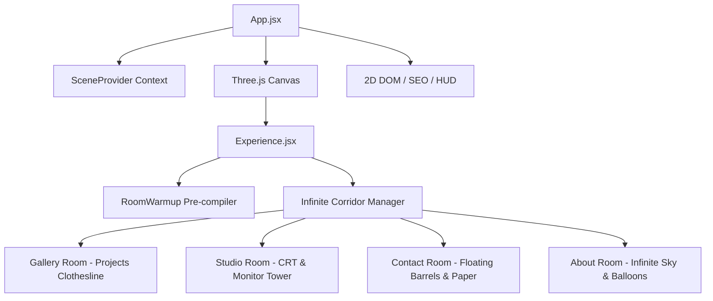

# 🎨 Prem Kumar | Interactive 3D WebGL Portfolio

<div align="center">
  
  
  
  
  
</div>

<br/>

> **"Building Digital Experiences That Perform, Rank & Grow."**

Welcome to the interactive 3D developer portfolio of **Prem Kumar** — Developer & Digital Product Builder. Combining full-stack Laravel engineering, React frontend architectures, technical SEO, and conversion-oriented product strategy.

---

## 👨‍💻 About Prem Kumar

- **Primary Title:** Developer & Digital Product Builder
- **Professional Roles:**
  - Laravel Developer
  - Full-Stack Developer
  - Website Creator
  - SEO Specialist
  - Digital Marketing Professional
  - SMM Professional
- **Location:** Puducherry, India
- **GitHub:** [github.com/premdevexe](https://github.com/premdevexe)

---

## 🌟 Featured Projects

1. **NammahSpot** ([nammahspot.in](https://nammahspot.in/)) — Local business discovery platform focused on connecting users with local businesses and providing technical local SEO indexing.
2. **Nool & Crop** ([noolandcrop.in](https://noolandcrop.in/)) — Modern e-commerce storefront presenting products through an optimized shopping experience and streamlined checkout.
3. **Cloudaspire** — Digital marketing & web solutions in Puducherry, India, accelerating business growth through modern web engineering and SEO.
4. **OpusZen** — High-throughput API gateway architecture, provider integrations, and secure microservice endpoints.
5. **The Flash Provider** — Social media marketing platform and service management system.
6. **Nura City** — Digital city and local discovery platform concept.

---

## 🚀 Key Performance Architectures

1. **Semantic SEO Fallback:** Bypasses WebGL canvas SEO limitations via strategic accessible DOM injections (`#seo-content`), providing structured metadata and JSON-LD to search engines.
2. **Asynchronous Shader Pre-compilation:** Enforces `gl.compileAsync` during the preloading phase inside a hidden `RoomWarmup` Suspense boundary to prevent frame drops.
3. **Baked Hand-Drawn Paper Aesthetic:** Custom sketch and painted texture pipelines with custom shader material transitions (`usePaintMaterial`).
4. **Adaptive Device Tiering:** Automatically scales resolution, frame rates, and texture tiers based on device memory and hardware concurrency.

---

## 🏗️ 3D Scene Architecture



---

## 🛠️ Local Development Setup

```bash
# 1. Install dependencies
npm install

# 2. Start local Vite development server
npm run dev

# 3. Production build
npm run build

# 4. Preview build
npm run preview
```

---

## 📄 License & Attribution

- The source code architecture is licensed under the [MIT License](LICENSE).
- Originally based on the 3D portfolio template by [Tomasz Szmajda (ITom Poland)](https://github.com/ITomPoland/portfolio-itom).
- All personal assets, trademarks, logos, and copywriting are copyright of **Prem Kumar** and respective project owners.
